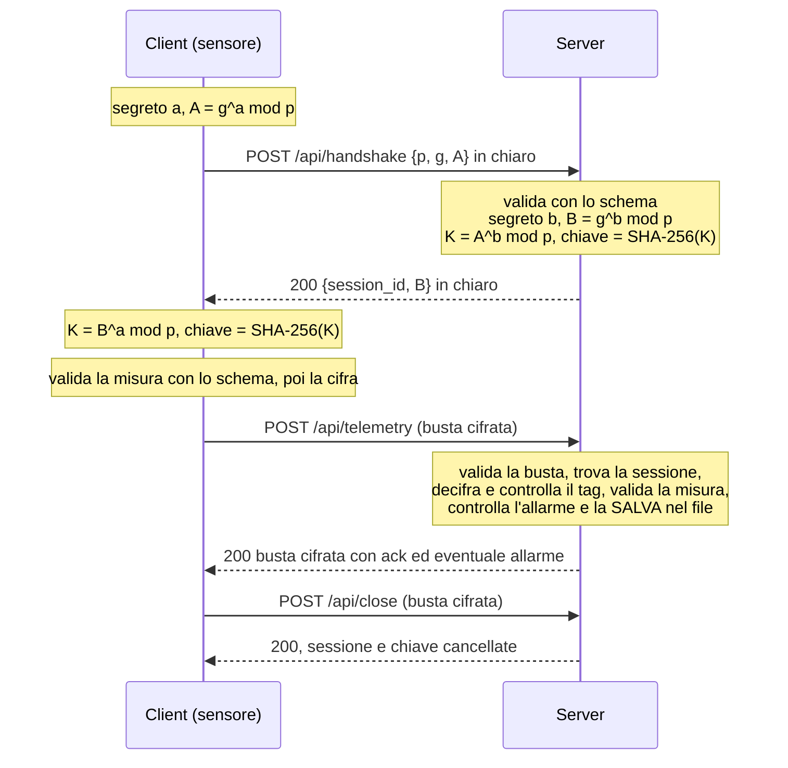

# FrigoTrack – Telemetria sicura per la catena del freddo

Sensori di temperatura (client) inviano misure in JSON a un server HTTP. Il canale resta **HTTP**: la sicurezza la fa l'applicazione.

- La chiave si concorda con **Diffie-Hellman** e **non viaggia mai in rete**.
- I messaggi viaggiano cifrati con **AES-256-GCM**, che scopre anche le manomissioni.
- Ogni messaggio è validato con **JSON Schema**: le regole stanno in `schemas/` e le applica la libreria **JsonSchema.Net**.
- Il server **salva le misure** nel file JSON `Server/data/readings.json`.

C# / .NET 8, **due progetti separati**. Il server usa `HttpListener` (incluso in .NET); l'unico pacchetto NuGet è `JsonSchema.Net` 7.3.1, che Visual Studio scarica da solo.

## Struttura

```
FrigoTrack/
├── schemas/                 10 schemi JSON, uno per tipo di messaggio (usati da entrambi i progetti)
├── Server/                  Server.sln
│   ├── Program.cs           tutto il server: endpoint, sessioni, allarmi, salvataggio
│   ├── Crypto.cs            Diffie-Hellman e AES-GCM
│   ├── SchemaValidator.cs   validazione con JSON Schema
│   └── data/readings.json   misure salvate (lo crea il server)
└── Client/                  Client.sln
    ├── Program.cs           menu, 3 sensori, demo
    ├── Connection.cs        handshake e invio cifrato
    ├── Tests.cs             6 test
    ├── Crypto.cs            uguale a quello del Server
    └── SchemaValidator.cs   uguale a quello del Server
```

`Crypto.cs` e `SchemaValidator.cs` sono uguali nei due progetti: se ne modifichi uno, copia la modifica nell'altro.

## Avvio (Visual Studio 2022, .NET 8; la prima volta serve Internet per il pacchetto)

1. Apri `Server/Server.sln` e premi **F5**.
2. In una **seconda** finestra di Visual Studio apri `Client/Client.sln` e premi **F5**. Dal menu scegli:
   `1` i 3 sensori · `2` demo con una misura valida e una non valida · `3` i test.

Da terminale: `cd Server && dotnet run`, poi in un altro terminale `cd Client && dotnet run`.

## Protocollo



Gruppo Diffie-Hellman n. 14 dell'RFC 3526 (`p` da 2048 bit, `g = 2`). I numeri grandi viaggiano in esadecimale.

| Endpoint (POST) | Richiesta | Risposta |
|---|---|---|
| `/api/handshake` | `{p, g, A}` in chiaro | `{session_id, B}` in chiaro |
| `/api/telemetry` | busta con la misura | busta con l'ack (ed eventuale allarme) |
| `/api/readings` | busta con `{sensor_id, from?, to?}` | busta con `{sensor_id, count, readings}` |
| `/api/close` | busta con `{"action":"close"}` | busta con `{"status":"closed"}` |

| Codice | Quando |
|---|---|
| 200 | tutto bene |
| 400 | messaggio rifiutato dallo schema, oppure busta manomessa (il tag non torna) |
| 401 | sessione scaduta (10 minuti senza messaggi) |
| 404 | sessione inesistente o endpoint sconosciuto |

**Busta**: `{"session_id": "...", "ciphertext": "Base64(nonce + testo cifrato)", "tag": "Base64(tag GCM)"}`. Solo `session_id` è in chiaro.
Regola del server: **prima decifra, poi valida**; se il tag non torna risponde 400 senza elaborare nulla.

**Errore** (indica il campo sbagliato; messaggi della libreria, in italiano):
```json
{ "error": "99 è maggiore di 40", "field": "temperature_c" }
```

**Misura**:
```json
{ "sensor_id": "CELLA-BG-007", "timestamp": "2026-11-02T08:15:30Z", "cargo_type": "pharma",
  "temperature_c": 4.6, "humidity": 55, "battery": 87 }
```

**Schemi** (`schemas/`): `handshake-request`, `handshake-response`, `envelope`, `telemetry`, `telemetry-ack`, `readings-request`, `readings-response`, `close-request`, `close-response`, `error`.
Chi riceve un messaggio lo valida con il suo schema; il client valida anche ciò che invia, prima di cifrarlo. Gli schemi delle risposte del server sono usati nei test.

**File delle misure** `Server/data/readings.json`: ogni misura accettata viene aggiunta con `received_at` e `alarm`, e il file viene riscritto. Al riavvio il server lo ricarica.

**Allarmi**: `food` 0…4 °C, `pharma` 2…8 °C, `frozen` −25…−18 °C.

## Test (voce 3 del menu, server acceso)

1 handshake riuscito · 2 messaggio valido → 200 · 3 messaggio non valido → 400 con il campo · 4 busta manomessa → 400 · 5 sessione inesistente → 404 · 6 misura salvata e riletta con `/api/readings`.
